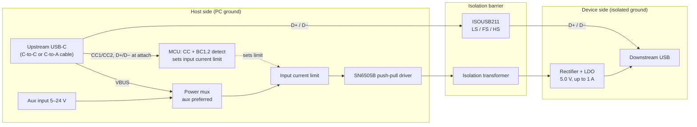

# usb2-480mbps-isolator

Open-source, hand-solderable galvanic isolator for **USB 2.0 at all speeds, including 480 Mbit/s high speed**, with up to **1 A of isolated 5 V power**.

> **Status:** early design. Nothing here is tested yet, and the board is **functional isolation only**: it is not certified for safety isolation. See [Safety](#safety).

## Why another USB isolator?

Isolating USB breaks ground loops and protects a PC when working on mains-referenced, motor-drive or other noisy hardware. Isolators that pass high speed exist, but:

- bus-powered ones top out at about **300 mA** on the isolated side, which isn't enough for many dev boards, logic analysers or scopes;
- none of them read the USB-C port's current advertisement, or detect a USB-A charging port, to make use of the extra power available.

This project aims to fill that gap: an openly licensed design that **reads the USB-C CC pins** (if available) and raises its power budget when the host port can supply it.

## Target spec (v1)

| Parameter | Target |
| --- | --- |
| Data rates | Low / full / high speed (1.5 / 12 / 480 Mbit/s), detected automatically |
| Data isolator | TI [ISOUSB211](https://www.ti.com/product/ISOUSB211) (reinforced, 5 kVrms rated) |
| Upstream | USB-C receptacle, USB 2.0 only (use a C-to-C or C-to-A cable) |
| Downstream | USB-A or USB-C |
| Isolated output, standard USB port | about 300 mA at 5 V |
| Isolated output, USB-C port advertising 1.5 A or 3 A | **1 A at 5 V** |
| Isolated output, USB-A charging port (BC1.2 CDP, via C-to-A cable) | **1 A at 5 V** |
| Isolated output, auxiliary input (5–24 V, host side) | **1 A at 5 V** |
| Output ripple | under 20 mV peak to peak (goal) |
| Assembly | Hand-solderable: SSOP / SOIC / SOT-23, 0603 passives or larger |

## How it works



- **Data** crosses the barrier through the ISOUSB211, which handles speed detection and the USB 2.0 signalling on both sides.
- **Power** crosses through a push-pull converter and a small transformer, followed by a low-noise LDO.
- The **current limit sits on the host side** and is set by the CC reading, so no control signal has to cross the barrier. A C-to-A cable reads as a standard port. In that case the MCU runs a BC1.2 check on D+/D− before the isolator connects, and raises the limit to 1.5 A if the port is a charging data port (CDP).
- The **auxiliary input is on the host side** and feeds the same isolated converter, so plugging in external power never bridges the barrier.

### Power budget

| Upstream source | Available | Isolated output (about 80% efficient) |
| --- | --- | --- |
| Standard USB 2.0 / 3.x port (USB-A via C-to-A cable, or USB-C with no advertisement) | 500 mA (2.5 W) | about 300 mA |
| USB-C, advertising 1.5 A | 1.5 A (7.5 W) | 1 A |
| USB-A charging data port (BC1.2 CDP) | 1.5 A (7.5 W) | 1 A |
| USB-C, advertising 3 A | 3 A (15 W) | 1 A (capped by the converter) |
| Auxiliary input, 5–24 V | Supply-limited | 1 A |

A USB 3 port's 900 mA allowance doesn't apply, because anything behind the isolator enumerates as USB 2.0.

## Repository layout (planned)

```
hardware/     KiCad project, BOM, Gerbers per release
test/         Test procedures and results
```

## Roadmap

- [ ] Characterise the TI ISOUSB211 EVM: HS enumeration, throughput, power limit, noise baseline
- [ ] Choose the MCU for CC and BC1.2 CDP detection
- [ ] Choose CDP detection hardware and check its effect on HS signal quality on the EVM
- [ ] Choose power stage (discrete SN6505B or a 6 W isolated module)
- [ ] Schematic and layout, rev A
- [ ] Build and test rev A: data, power at each source, ripple, 1 A load step
- [ ] Publish BOM with DigiKey and LCSC part numbers

## Safety

This design provides **functional isolation** for breaking ground loops and protecting equipment during development. It has **not** been hipot tested or certified, and it must **not** be relied on for protection from hazardous voltages. The data isolator is reinforced-rated, but the board's overall rating depends on the transformer, creepage distances and layout, which are not qualified in v1.

## Licence

Copyright davhodg 2026.

This source describes Open Hardware and is licensed under the [CERN-OHL-S v2](LICENSE) (SPDX: `CERN-OHL-S-2.0`).

You may redistribute and modify this source and make products using it under the terms of the CERN-OHL-S v2. This source is distributed WITHOUT ANY EXPRESS OR IMPLIED WARRANTY, INCLUDING OF MERCHANTABILITY, SATISFACTORY QUALITY AND FITNESS FOR A PARTICULAR PURPOSE. Please see the CERN-OHL-S v2 for applicable conditions.

<!-- Add firmware/ for the CC/CDP-detect MCU, with its own MIT licence. -->
