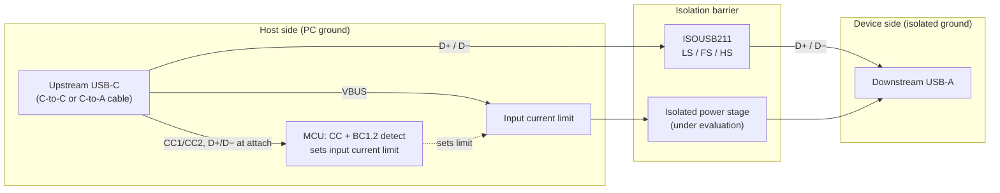

# usb2-480mbps-isolator

Open-source, hand-solderable galvanic isolator for **USB 2.0 at all speeds, including 480 Mbit/s high speed**, that **detects how much current the host port can supply and limits its input to match**.

> **Status:** early design and bench testing. No board has been built yet. The design is **functional isolation only**: it is not certified for safety isolation. See [Safety](#safety).

## Why another USB isolator?

Isolating USB breaks ground loops and protects a PC when working on mains-referenced, motor-drive or other noisy hardware. Isolators that pass high speed exist, but:

- bus-powered ones supply about 300–400 mA on the isolated side, and most don't publish measurements to back their figures;
- none that we found read the USB-C port's current advertisement, or detect a USB-A charging port, to make use of the extra power available.

This project aims to fill that gap with an openly licensed design and published test data.

## Decided so far

| Item | Decision |
| --- | --- |
| Data isolator | TI [ISOUSB211](https://www.ti.com/product/ISOUSB211): low, full and high speed (1.5 / 12 / 480 Mbit/s), detected automatically. Reinforced, 5 kVrms rated |
| Upstream | USB-C receptacle, USB 2.0 only (use a C-to-C or C-to-A cable) |
| Downstream | USB-A |
| Host current detection | An MCU reads the USB-C CC advertisement (default / 1.5 A / 3 A). With a C-to-A cable it runs a BC1.2 check on D+/D− for a charging data port (CDP) before the isolator connects |
| Input current limit | On the host side, set from the detection result, so no control signal has to cross the barrier |
| MCU | STM32C0 (STM32C031, TSSOP-20) |
| Main design aim | The highest in-spec isolated output current (≥ 4.75 V) from a **standard 500 mA port**. Efficiency at 300–400 mA and idle loss decide the power stage |
| Assembly | Hand-solderable: SSOP / TSSOP / SOIC / SOT-23 and similar, 0805 passives or larger |

The isolated power stage, and so the output current, is **not decided yet**. It is being chosen from bench measurements (below).

## How it works



- **Data** crosses the barrier through the ISOUSB211, which handles speed detection and the USB 2.0 signalling on both sides.
- **Power** crosses through an isolated converter; which kind is still being tested.
- The **current limit sits on the host side** and is set from the port detection. A USB 3 port's 900 mA allowance doesn't apply, because anything behind the isolator enumerates as USB 2.0.

## Measured so far

### TI ISOUSB211 EVM power stage (1:1.1 push-pull + LDO), 31 Oct 2026

The EVM's isolated supply is an SN6505A push-pull driver, a Würth 750315240 (1:1.1) transformer, Schottky rectifiers and a TPS73701 LDO set to about 5.1 V. Input from a bench supply, set at the EVM's input test point; DC values with a multimeter; ripple at the downstream socket, after the EVM's ferrite bead.

| Output current | Rectified (LDO input) | Output | Efficiency | Ripple at socket |
| --- | --- | --- | --- | --- |
| 0 | 5.11 V | 5.11 V | — (idle input 40 mA) | < 1 mV |
| 200 mA | 4.96 V | 4.94 V | 78% | 0.84 mV |
| 400 mA | 4.86 V | 4.82 V | 81% | 1.44 mV |
| 500 mA | 4.78 V | 4.73 V | 80% | 1.88 mV |
| 800 mA | 4.62 V | 4.53 V | 78% | 2.74 mV |
| 990 mA | 4.51 V | 4.41 V | 79% | 3.46 mV |

All at 5.00 V in. Fitted model: rectified ≈ 1.1 × Vin − 0.39 V − 0.6 Ω × Iout, linear to 1 A (checked at 4.75, 5.00 and 5.25 V in).

What it shows:

- **The output stays at or above 4.75 V only to about 480 mA at 5.00 V in, and about 100 mA at 4.75 V in.** The LDO is in dropout from no load, so the output follows the rectified voltage down. A 1:1.1 ratio doesn't leave enough headroom.
- Efficiency is about 78–81% from 200 mA up, and noise after the EVM's filtering is very low.

## Power-stage options being tested

| Option | Idea |
| --- | --- |
| Push-pull, 1:1.3 transformer + low-dropout LDO | Enough headroom at 4.75 V in. Stock 1:1.3 parts are rated about 0.65 A, so a second stage in parallel would be needed for more |
| Push-pull, higher ratio (about 1:1.5–1:2) + buck converter on the isolated side | The buck removes the dependence on an exact transformer ratio |
| TRACO TMR 6-0511 isolated module + LC filter | Regulated, 4.5–9 V input; noisier, and functional isolation only |

Each will be compared on the same test: the highest output current that stays at or above 4.75 V with the input limited to a 500 mA port, at 4.75 V and 5.00 V in, plus idle current, efficiency and ripple.

## Repository layout (planned)

```
hardware/     KiCad project, BOM, Gerbers per release (CERN-OHL-S-2.0)
firmware/     CC/CDP-detect MCU firmware (Apache-2.0)
test/         Test procedures and results
```

## Roadmap

- [x] Choose the MCU for CC and BC1.2 CDP detection: STM32C0 (STM32C031, TSSOP-20)
- [x] Measure the ISOUSB211 EVM's power stage (1:1.1 + LDO)
- [ ] Test the power-stage options above and choose one
- [ ] Characterise the ISOUSB211 EVM data path: HS enumeration, throughput, LS/FS coverage
- [ ] Choose CDP detection hardware and check its effect on HS signal quality on the EVM
- [ ] Schematic and layout, rev A
- [ ] Build and test rev A: data, power from each port type, ripple, load steps
- [ ] Publish BOM with DigiKey and LCSC part numbers

## Safety

This design provides **functional isolation** for breaking ground loops and protecting equipment during development. It has **not** been hipot tested or certified, and it must **not** be relied on for protection from hazardous voltages. The data isolator is reinforced-rated, but the board's overall rating depends on the power stage, creepage distances and layout, which are not qualified.

## Licence

Copyright davhodg 2026.

| Part | Licence | SPDX |
| --- | --- | --- |
| Hardware (everything except `firmware/`) | [CERN-OHL-S v2](LICENSE) | `CERN-OHL-S-2.0` |
| Firmware for the CC/CDP-detect MCU (`firmware/`) | [Apache License 2.0](firmware/LICENSE-Apache-2.0.txt) | `Apache-2.0` |

**Hardware:** this source describes Open Hardware and is licensed under the CERN-OHL-S v2. You may redistribute and modify this source and make products using it under the terms of the CERN-OHL-S v2. This source is distributed WITHOUT ANY EXPRESS OR IMPLIED WARRANTY, INCLUDING OF MERCHANTABILITY, SATISFACTORY QUALITY AND FITNESS FOR A PARTICULAR PURPOSE. Please see the CERN-OHL-S v2 for applicable conditions.

**Firmware:** licensed under the Apache License, Version 2.0. You may not use the files in `firmware/` except in compliance with the License. Unless required by applicable law or agreed to in writing, software distributed under the License is distributed on an "AS IS" BASIS, WITHOUT WARRANTIES OR CONDITIONS OF ANY KIND, either express or implied. See the License for the specific language governing permissions and limitations under the License.
